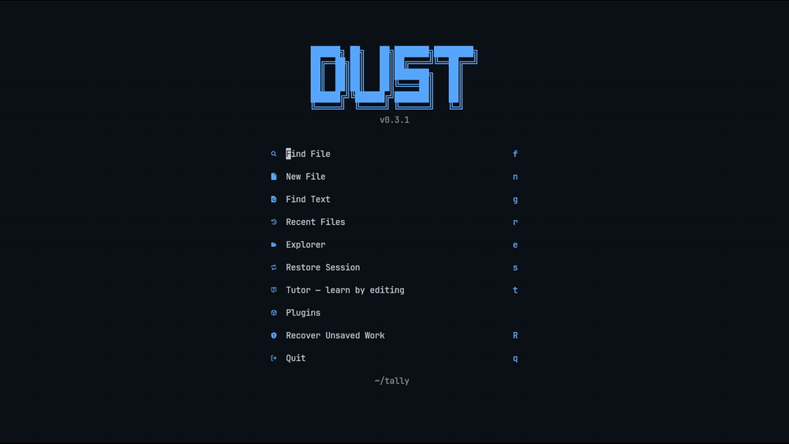
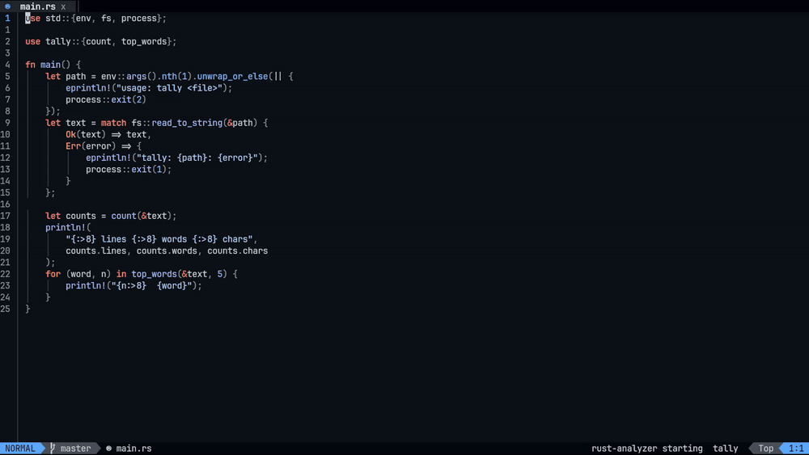
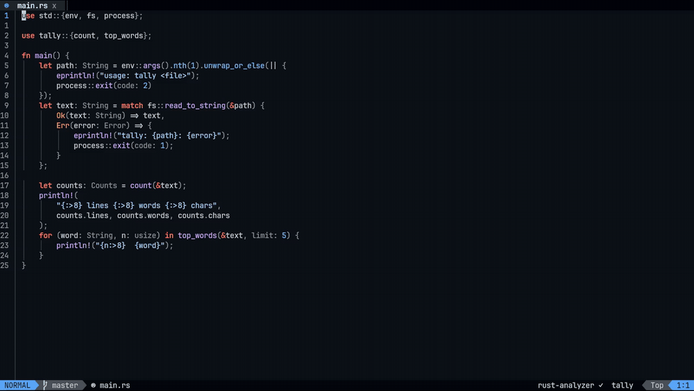
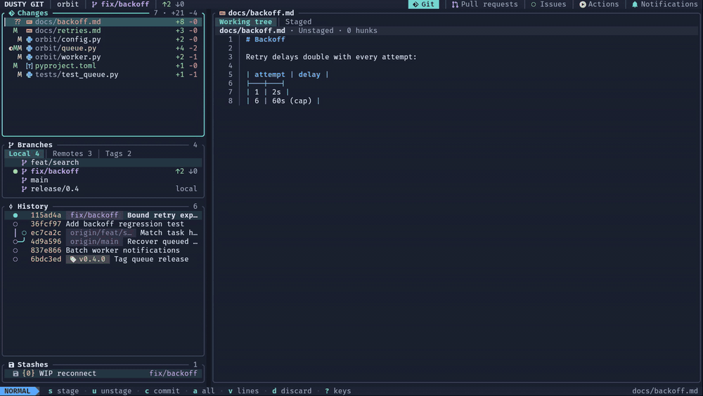

# Dusty

Dusty is a terminal IDE I use every day. It edits like Vim, with LazyVim-style keys out of the box.

One Rust binary gives you a file explorer, fuzzy finding, Tree-sitter highlighting, LSP support, DAP debugging, Git signs and hunks, terminals, an ACP coding-agent panel, and a tool installer. Settings and keymaps are TOML. No Lua needed.

Language servers, debug adapters, agents and outside tools run as separate programs. Dusty can install the ones it supports. Neovim plugins do not run here.

Git lives in **Dusty Git**, built in (`Space g g`) and also its own program, `dusty-git`. It does staging, history, branches, stashes and rebases, and pull requests, issues, CI runs and notifications on GitHub, GitLab, Gitea and Forgejo.

## A quick look

Starting from the dashboard, finding a file, making Vim edits, then saving to format it.

[](docs/media/editing.mp4)

Browsing the explorer, searching workspace text, and jumping with the file finder.

[](docs/media/search.mp4)

Hover, go to definition, completion, and an inline type error with rust-analyzer.

[](docs/media/lsp.mp4)

Staging and committing in Dusty Git, then a pull request's conversation, commits, checks and diff.

[](docs/media/git.mp4)

## Install on Linux

Download a binary or package from [releases](https://github.com/dustyhq/dusty/releases). For the static x86_64 binary:

```sh
mkdir -p ~/.local/bin
install -m 0755 dusty-0.4.0-x86_64-linux ~/.local/bin/dusty
```

The `.tar.zst` archive and the packages also install `dusty-git`, and `dusty-git-0.4.0-x86_64-linux` is the bare binary. Ensure `~/.local/bin` is on your `PATH`. Debian, RPM, pacman, AppImage and Flatpak instructions and checksum verification are in the [Linux release guide](docs/release-linux.md).

To build from source, use the pinned Rust toolchain plus a C compiler, `pkg-config`, OpenSSL and zlib development files, or enter the Nix development shell:

```sh
nix develop          # optional; provides the Linux build environment
cargo build --release --locked
./target/release/dusty
```

See [CONTRIBUTING.md](CONTRIBUTING.md) for tests and plugin-fixture builds.

## Install on macOS

Download `dusty-0.4.0-aarch64-macos.tar.gz` for Apple Silicon or `dusty-0.4.0-x86_64-macos.tar.gz` for Intel from [releases](https://github.com/dustyhq/dusty/releases). Check the archive's SHA-256 against its entry in `SHA256SUMS`, then extract and install it:

```sh
tar -xzf dusty-0.4.0-aarch64-macos.tar.gz
mkdir -p ~/.local/bin
install -m 0755 dusty dusty-git ~/.local/bin/
```

Put `~/.local/bin` on `PATH`. These binaries are not Developer ID signed or notarized. If macOS quarantines the verified executable, run:

```sh
xattr -d com.apple.quarantine ~/.local/bin/dusty ~/.local/bin/dusty-git
```

See the [macOS and Windows guide](docs/user-guide-macos-windows.md) for configuration paths and shell selection.

## Install on Windows

Download `dusty-0.4.0-x86_64-windows.zip` from [releases](https://github.com/dustyhq/dusty/releases) and check its SHA-256 against its entry in `SHA256SUMS`. In PowerShell:

```powershell
Get-FileHash dusty-0.4.0-x86_64-windows.zip
Expand-Archive dusty-0.4.0-x86_64-windows.zip -DestinationPath "$env:LOCALAPPDATA\Programs\Dusty"
```

Add `%LOCALAPPDATA%\Programs\Dusty` to your user `PATH` and run `dusty` (or `dusty-git`) in Windows Terminal. The binary is not Authenticode signed, so SmartScreen may ask before the first run. The [macOS and Windows guide](docs/user-guide-macos-windows.md) covers configuration paths, shells and what differs on Windows.

## First run

```sh
dusty                 # dashboard in the current directory
dusty path/to/file    # edit a file
dusty path/to/project # dashboard rooted at a directory
dusty --clean         # use bundled configuration
```

Only trust workspaces whose code you are willing to execute. Escape dismisses the workspace trust prompt; `:trust` approves it later. ACP agents are ordinary child processes and can run even in untrusted workspaces or safe mode.

`i` inserts text. Escape goes back to Normal mode. `:w` saves and `:q` quits. Space is the leader. `Space Space` finds files, `Space e` opens the explorer, `Space /` searches the workspace.

`F1` opens the command palette. `:Tutor` opens the interactive tutor. `Space c m` opens the tool installer. `Space g g` opens Dusty Git.

On Linux, configuration defaults to `~/.config/dusty/config.toml`, with `keymaps.toml` and `dashboard.toml` beside it. See the [Linux user guide](docs/user-guide-linux.md) for XDG overrides, trust, recovery and daily workflows. Bundled [settings](assets/defaults/config.toml), [keymaps](assets/defaults/keymaps.toml) and [dashboard actions](assets/defaults/dashboard.toml) are the reference defaults.

## Dusty Git

```sh
dusty-git                    # the repository in the current directory
dusty-git path/to/repo
dusty-git open https://github.com/owner/repo/pull/12   # a pull request, issue or run
```

The tabs along the top are Git, Pull requests, Issues, Actions and Notifications. On GitLab they use GitLab's names: Merge requests, Pipelines, To-dos. Lists open from the cache straight away and refresh in the background. `?` shows the keys for whatever is on screen.

It signs in with what you already have: the forge's CLI (`gh`, `glab`, `fj` or `tea`) or a token variable like `GH_TOKEN`, `GITLAB_TOKEN` or `FORGEJO_TOKEN`. It never asks for a token and never shows one. Without a sign-in, public repositories open read-only, and `@` shows how to sign in. Self-hosted forges are detected from the remote, or you can name one in `config.toml`:

```toml
[forge.hosts."git.example.com"]
provider = "forgejo"   # github, gitlab, gitea or forgejo
```

`:tutor git` teaches the Git tab in a throwaway repository. `:tutor forge` teaches the forge tabs against a practice forge on your machine (it needs `python3`). Neither needs an account. `ui.git.keys = "lazygit"` switches to lazygit's keys. The [Linux user guide](docs/user-guide-linux.md#forge-tabs) covers every sign-in, the cache and the keys.

## Plugins

Dusty loads WebAssembly Component Model plugins. A plugin can add commands, modes and keys, edit buffers with normal undo, draw highlights and signs, publish diagnostics, provide completion and formatters, and add status-line parts. Its manifest decides what it may do. File, process and network access need your grant. Granting process execution gives it normal user-process access, not a sandbox.

Open **Plugins** on the dashboard or run `:plugins` to inspect installed plugins, permissions and failures, enable or disable them for the session, reload, or open their folders. `dusty plugin new mywords` creates a ready-to-build Rust guest with build, pack and load steps in its README.

The [Plugin SDK](docs/plugin-sdk.md) documents the WIT contract, manifest, build commands and examples. [Registry client documentation](docs/registry-client.md) describes package installation and verification.

## License

Dusty is **GPL-3.0-or-later**; see [LICENSE](LICENSE). The public plugin ABI and SDK contract are **Apache-2.0**. Bundled third-party notices and license texts are in [NOTICE](NOTICE) and [LICENSES/](LICENSES/).

[Architecture](ARCHITECTURE.md) · [Contributing](CONTRIBUTING.md) · [Documentation](docs/README.md)
